# 📱 Awesome Low-Code Mobile Test Automation 🚀

  
  
  
  
  
  

  <strong>A curated collection of top Low-Code Mobile Test Automation tools, codeless frameworks, AI test recorders, and cloud execution farms for iOS and Android.</strong> 
  ✨ <em>Empowering QA engineers, SDETs, and mobile developers to automate mobile testing with minimal coding!</em> ✨

  🌟 <strong>Star this repository to show your support and stay updated!</strong> 🌟

---

## 📌 Table of Contents

- [🔍 Overview & Key Concepts](#-overview--key-concepts)
- [📈 Sector Overview & Market Dynamics](#-sector-overview--market-dynamics)
- [🟦 SaaS / Hosted Platforms](#-saas--hosted-platforms)
- [🟩 Open-Source Software](#-open-source-software)
- [📊 Feature Comparison Matrix](#-feature-comparison-matrix)
- [🎯 Selection Guide / How to Choose](#-selection-guide--how-to-choose)
- [🤝 Contributing](#-contributing)
- [💖 Support & Community](#-support--community)
- [⭐ Star History](#-star-history)
- [📄 License](#-license)

---

## 🔍 Overview & Key Concepts

Mobile test automation has evolved beyond manual scripting. **Low-code mobile test automation** platforms leverage AI-assisted authoring, computer-vision element matching, declarative YAML workflows, and visual record-and-replay to:
- ⚡ **Accelerate QA Velocities:** Drastically reduce test creation time from hours to minutes.
- 🛠️ **Eliminate XPath & ID Flakiness:** Leverage multi-locator algorithms and AI self-healing when mobile UI elements change.
- 📱 **Cross-Platform Parity:** Automate seamless end-to-end tests across native (Swift, Kotlin), cross-platform (Flutter, React Native), and hybrid webview apps.
- 🤝 **Bridge the Skill Gap:** Empower non-coding QA analysts, product managers, and manual testers to contribute directly to automated regression suites.

---

## 📈 Sector Overview & Market Dynamics

The global mobile application testing market is valued at approximately **$7 billion to $14 billion** (projected to reach over $25 billion by 2032 at an estimated CAGR of **13%–17%**), driven by rapid mobile release cadences, diverse OEM form factors, and AI-assisted QA tooling. The sector exhibits a **moderately fragmented yet top-heavy structure**: enterprise spend is concentrated among continuous quality heavyweights (such as Tricentis, BrowserStack, and Sauce Labs), while a thriving, highly fragmented long-tail of innovative AI-native SaaS startups and dominant open-source ecosystems (led by Appium and Maestro) continuously shape developer workflows.

---

## 🟦 SaaS / Hosted Platforms

Commercial, cloud-hosted low-code mobile test automation platforms sorted in descending order by estimated company size (valuation / annual revenue).

| Platform | Company Valuation / Revenue Size | Starting Paid Pricing | Free Forever Limit / Free Trial Limit | Best For | Core Highlights |
| :--- | :--- | :--- | :--- | :--- | :--- |
| **[Waldo (Tricentis)](https://www.tricentis.com/products/testim-mobile)** | 🏢 **$4.5B Valuation** / ~$500M ARR (Parent: Tricentis) | 💵 **$150/month per user** (billed annually via Tricentis suite entry) | ⏱️ **14-day free trial** with access to cloud virtual devices; enterprise PoC sandbox available | 🎯 Hybrid (React Native / Flutter) and native apps needing deep element inspection | ⚡ Proprietary view-tree parser that maps complex hybrid view hierarchies, session replay, and zero Appium configuration. |
| **[Testim Mobile](https://www.tricentis.com/products/testim-mobile)** | 🏢 **$4.5B Valuation** / ~$500M ARR (Parent: Tricentis) | 💵 **$150/month per seat** (billed annually under Tricentis test management) | 🎁 **Free Community Tier:** 1,000 test runs/month, 1 active execution slot, and 14-day full Pro trial | 🎯 Cross-platform teams (React Native, Flutter) with web/mobile parity requirements | 🤖 AI-powered Smart Locators, Enhanced Mode for shadow DOM/embedded views, and cross-platform grid management. |
| **[BrowserStack App Low-Code Automation](https://www.browserstack.com/app-automate)** | 🏢 **$4.0B Valuation** / ~$230M ARR | 💵 **$199/month per parallel test** (billed annually for App Automate) | ⏱️ **Free Trial:** 100 minutes of automated mobile testing across real iOS/Android devices | 🎯 Enterprise & high-velocity teams needing massive real-device coverage | 🌐 Natural-language test prompt generation, AI-assisted self-healing selectors, and access to 30,000+ real mobile devices. |
| **[Katalon Studio](https://katalon.com/)** | 🏢 **~$30M Total Funding** / ~$40M–$60M ARR | 💵 **$150/month per seat** (Studio Pro, billed annually at $1,800/yr) | 🎁 **Free Forever Edition:** Unlimited manual local IDE tests, plus a **30-day free trial** of Enterprise & Cloud Engine features | 🎯 Teams transitioning from manual QA to structured, low-code keyword pipelines | 📱 Cloud Mobile Recorder on remote devices, object tree inspection, AI self-healing locators, and dual-mode script/GUI editing. |
| **[Sofy.ai](https://sofy.ai/)** | 🏢 **~$9.6M Total Funding** / ~$5M–$15M ARR | 💵 **$549/month** (Starter tier billed annually; ~$49/mo limited ad-hoc runner) | ⏱️ **Free Trial:** 14-day guided product trial with 100 real-device execution minutes | 🎯 Teams looking for no-code autonomous AI testing agents on real hardware | 🦾 Autonomous test execution, performance profiling (battery, CPU, memory), and automated app-store compliance checks. |
| **[Maestro Cloud (mobile.dev)](https://cloud.mobile.dev/)** | 🏢 **~$3.0M Seed Funding** (mobile.dev) / Early-stage SaaS | 💵 **$250/month per concurrent device** | ⏱️ **7-day free trial** with parallel device execution credits; local CLI/Studio is 100% free forever | 🎯 High-cadence mobile teams running declarative YAML flows in CI/CD | 🚀 Fast parallel execution, automated emulator wipe between test runs, zero setup overhead, and deep GitHub Actions integration. |
| **[Repeato](https://www.repeato.app/)** | 🏢 **Bootstrapped / Seed** / Micro-SaaS | 💵 **$70/month per user** (Basic tier, billed monthly) | 🎁 **Free Forever Tier:** 5 Android tests, 5 iOS tests, 5 Web tests, 20 AI vision assertions/month, 5 cloud mins/month | 🎯 Privacy-focused teams and games/apps without accessible element IDs | 👁️ Pixel-based computer vision & OCR recognition, local-first offline storage, and source-code-independent test creation. |

---

## 🟩 Open-Source Software

Community-driven, open-source mobile test automation tools and low-code utilities, sorted in descending order by GitHub stargazers.

| Project | GitHub_Stars | License | Primary Tech Stack | Low-Code / Test Creation Style | Key Features & Architecture |
| :--- | :--- | :--- | :--- | :--- | :--- |
| **[Appium](https://github.com/appium/appium)** |  | ⚖️ Apache-2.0 | 💻 Node.js / Multi-language clients | ⌨️ Code-first engine; low-code via Inspector GUI & visual recorders | 🏆 Foundational standard for cross-platform automation across iOS, Android, and Windows via W3C WebDriver. Fastest baseline benchmark performance. |
| **[Maestro](https://github.com/mobile-dev-inc/maestro)** |  | ⚖️ Apache-2.0 | 💻 Java / Kotlin / YAML | 📝 Declarative YAML-based flows & Maestro Studio interactive inspector | ⚡ Zero-setup declarative syntax, built-in screen settling tolerance to eradicate flakiness, and full support for React Native, Flutter, and native UI. |
| **[Airtest](https://github.com/AirtestProject/Airtest)** |  | ⚖️ Apache-2.0 | 💻 Python / OpenCV / PyQt | 👁️ Visual record-and-replay via AirtestIDE, image recognition & OCR | 🎮 Cross-platform framework by NetEase utilizing image recognition to locate UI elements without source code. Exceptional for gaming and complex canvas apps. |
| **[SoloPi](https://github.com/alipay/SoloPi)** |  | ⚖️ Apache-2.0 | 💻 Android Java / Desktop / CLI | 📲 On-device record-and-replay, multi-device sync, and AI harness | 📡 Alipay's wireless, non-invasive automated testing tool. Enables recording flows on-device, synchronized multi-device execution, and real-time performance tracking. |
| **[Sonic](https://github.com/SonicCloudOrg/sonic-server)** |  | ⚖️ Apache-2.0 | 💻 Java / Spring Boot / Vue.js | 🖥️ Visual web portal, step-by-step low-code test designer | ☁️ Distributed cloud real-machine debugging and automation platform for iOS and Android devices, supporting visual remote control and batch execution. |
| **[Appium Inspector](https://github.com/appium/appium-inspector)** |  | ⚖️ Apache-2.0 | 💻 Electron / React / TypeScript | 🔍 Visual UI tree inspector, point-and-click action recorder | 🛠️ The official GUI companion to Appium. Inspects native/hybrid mobile application view hierarchies, tests XPath/accessibility selectors, and records steps into boilerplate code. |
| **[Hydra Lab](https://github.com/microsoft/HydraLab)** |  | ⚖️ MIT | 💻 Java / Spring Boot / Docker | 🔄 Multi-engine runner (Appium, Maestro, Espresso, XCTest) | 🏢 Microsoft's enterprise-grade framework for self-hosting private device test clouds with a center-agent architecture and near-linear multi-device scalability. |
| **[OpenTest](https://github.com/mcdcorp/opentest)** |  | ⚖️ MIT | 💻 Java / Node.js | 🧱 Keyword-driven YAML / scriptless actions | 🧩 Open-source keyword-driven automation platform for mobile (via Appium), web, and APIs. Designed for non-programmers to create tests using high-level action building blocks. |
| **[Cerberus Testing](https://github.com/cerberustesting/cerberus-core)** |  | ⚖️ GPL-3.0 | 💻 Java / MySQL / Angular | 🌐 100% low-code / no-code web GUI test designer | 📊 Comprehensive open-source test management and execution platform that drives Appium, Selenium, and APIs from a single unified web portal. |
| **[Dogu](https://github.com/dogu-team/dogu)** |  | ⚖️ Open-Source | 💻 TypeScript / Rust | 🖥️ Visual desktop client & device streaming | ⚠️ Desktop GUI overlay on top of Appium for device streaming and test execution. *Note:* Inactive maintenance since 2022 and high overhead under parallel loads. |
| **[Pickleib](https://github.com/Umutayb/pickleib)** |  | ⚖️ MIT | 💻 Java / Cucumber / Appium | 🥒 Human-readable Gherkin/BDD step definitions & JSON selectors | 📚 Test automation utility library providing pre-configured Cucumber steps for mobile UI and Web, eliminating boilerplate glue code for BDD practitioners. |

---

## 📊 Feature Comparison Matrix

| Platform / Tool | Delivery Model | Authoring Style | iOS Support | Android Support | Cross-Platform (RN / Flutter) | Self-Healing Locators | Real-Device Cloud | Self-Hosted Option |
| :--- | :--- | :--- | :---: | :---: | :---: | :---: | :---: | :---: |
| **BrowserStack** | ☁️ Cloud SaaS | 🤖 AI / Plain English / Recorder | ✅ | ✅ | ✅ | ✅ | ✅ (30k+ devices) | ❌ |
| **Katalon Studio** | 💻 Desktop + Cloud | 🎥 Cloud Recorder / Low-Code IDE | ✅ | ✅ | ✅ | ✅ | ✅ (TestCloud) | ✅ (Desktop Engine) |
| **Testim Mobile** | ☁️ Cloud SaaS | 🧠 AI Smart Locators / Enhanced Mode | ✅ | ✅ | ✅ | ✅ | ✅ (Virtual Grid) | ❌ |
| **Repeato** | 💻 Desktop App | 👁️ Computer Vision / OCR | ✅ | ✅ | ✅ (No source needed) | ✅ (Visual Fuzzy) | ❌ (Local First) | ✅ |
| **Sofy.ai** | ☁️ Cloud SaaS | 🦾 Autonomous AI Agents | ✅ | ✅ | ✅ | ✅ | ✅ (2k+ devices) | ❌ |
| **Waldo** | ☁️ Cloud SaaS | 🌳 No-Code View Tree Recorder | ✅ | ✅ | ✅ | ✅ | ✅ (Hosted Simulators) | ❌ |
| **Maestro Cloud** | ☁️ Cloud Runner | 📝 Declarative YAML / Studio | ✅ | ✅ | ✅ | ✅ (Screen settling) | ✅ (Parallel Cloud) | ❌ |
| **Appium (Core)** | 🔓 Open-Source | ⌨️ Code / Appium Inspector | ✅ | ✅ | ✅ | ⚠️ (Requires plugins) | (Via external clouds) | ✅ |
| **Maestro (OSS)** | 🔓 Open-Source | 📝 Declarative YAML / Studio | ✅ | ✅ | ✅ | ✅ (Built-in tolerances) | (Via CI/Simulators) | ✅ |
| **Airtest** | 🔓 Open-Source | 🖼️ Image Recognition / AirtestIDE | ✅ | ✅ | ✅ (Games & Apps) | ⚠️ (Template matching) | (Via custom farm) | ✅ |
| **SoloPi** | 🔓 Open-Source | 📲 On-Device Wireless Record/Replay | ❌ (Android only) | ✅ | ✅ | ⚠️ (Accessibility based) | ❌ (On-device/Desktop) | ✅ |
| **Sonic** | 🔓 Open-Source | 🖥️ Web Portal Step Builder | ✅ | ✅ | ✅ | ❌ | ❌ (Private Cloud) | ✅ |
| **Hydra Lab** | 🔓 Open-Source | 🔄 Multi-Framework Center/Agent | ✅ | ✅ | ✅ | (Framework dependent) | ❌ (Private Cloud) | ✅ |
| **OpenTest** | 🔓 Open-Source | 🧱 Keyword-Driven YAML | ✅ | ✅ | ✅ | ❌ | (Via Appium grids) | ✅ |
| **Cerberus** | 🔓 Open-Source | 🌐 Web GUI Test Designer | ✅ | ✅ | ✅ | ❌ | (Via Appium grids) | ✅ |

---

## 🎯 Selection Guide / How to Choose

- 🏢 **For Enterprise Teams Needing Real Devices & Compliance:** Choose **BrowserStack** (massive device fleet, AI test generation) or **Katalon Studio** (structured keyword-driven IDE with enterprise TestOps).
- 🧬 **For Hybrid, React Native, or Flutter Apps with Complex Trees:** Choose **Testim Mobile** or **Waldo (Tricentis)** for their specialized object inspectors that bypass Appium's element hierarchy limitations.
- ⚡ **For Modern Mobile Devs Wanting Fast CI/CD Tests:** Adopt **Maestro (Open Source)** for local development with declarative YAML, scaling to **Maestro Cloud** for parallel regression test runs.
- 🎮 **For Mobile Games, Canvas, or Source-Code-Less Apps:** Choose **Repeato** (commercial) or **Airtest** (open-source) for computer-vision and pixel-based OCR test recording.
- 📲 **For On-Device Field Testing & Multi-Device Sync:** Deploy Alipay's **SoloPi** for lightweight, wireless on-device recording without PC dependencies.
- 🛠️ **For Enterprise Self-Hosted Mobile Device Farms:** Deploy Microsoft's **Hydra Lab** or **Sonic** to orchestrate your organization's physical device fleet with zero external cloud cost.

---

## 🤝 Contributing

Contributions are welcome! If you know of an active low-code, codeless, or declarative mobile test automation project that should be added:

1. 🍴 Fork this repository.
2. 🌿 Create a descriptive branch (`git checkout -b feature/add-new-tool`).
3. 📝 Add the project to the appropriate table and comparison sections, following existing alphabetical or sorted guidelines.
4. ✅ Ensure the tool is actively maintained with clear documentation.
5. 🚀 Submit a Pull Request.

---

## 💖 Support & Community

Thank you for exploring and utilizing this curated low-code mobile test automation guide! Continuous quality engineering moves fast, and maintaining high-quality resources takes dedicated research and maintenance.

If this repository has saved you time, helped you evaluate QA platforms, or improved your mobile testing strategy, please consider supporting the project:

- ⭐ **Star this repository** to improve visibility and help other QA engineers and mobile developers discover it.
- 🍴 **Fork and share** the project with your team, colleagues, and testing communities.
- ☕ **Buy a coffee & sponsor ongoing maintenance:** Support future updates and ecosystem tracking directly via the [GitHub Sponsors Dashboard](https://github.com/sponsors/ishandutta2007).

Your sponsorship and contributions keep this repository accurate, independent, and continuously up to date! ❤️

---

## 📈 Star History

---

## 📄 License

This repository is dedicated to the public domain under [Creative Commons Zero v1.0 Universal (CC0 1.0)](LICENSE).
